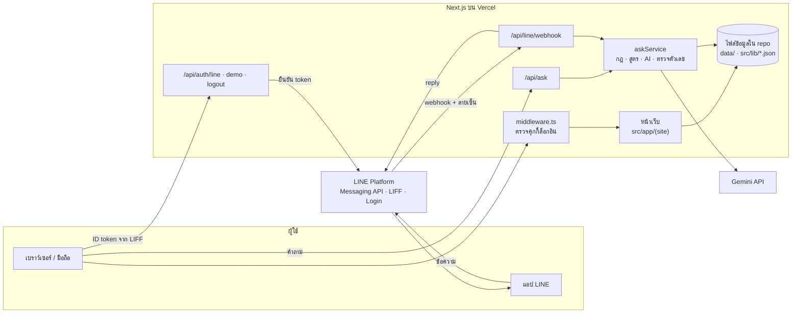
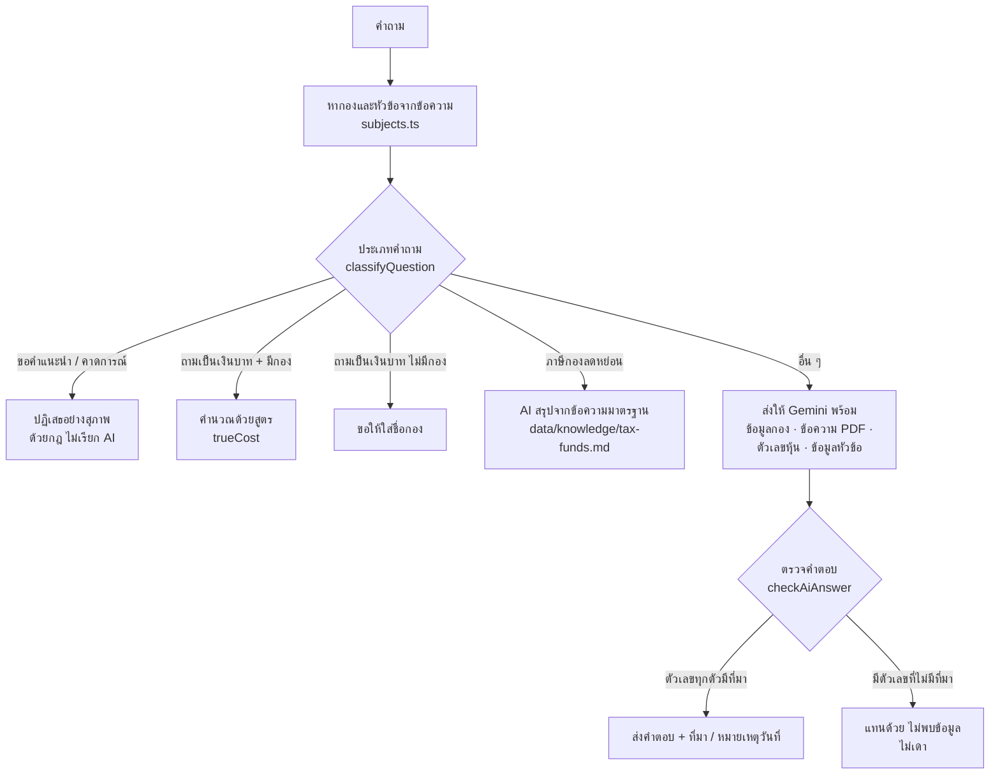
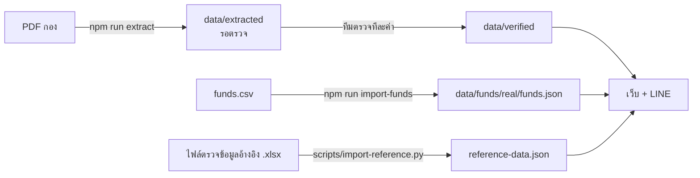

# สถาปัตยกรรม FinLens AI

เอกสารนี้อธิบายว่า FinLens AI ประกอบด้วยอะไรบ้าง ข้อมูลไหลอย่างไร และโค้ดแต่ละส่วนอยู่ที่ไหน
สำหรับทีมและผู้ที่ต้องการเข้าใจระบบก่อนแก้ไขหรือประเมินผลงาน

## ภาพรวม

FinLens AI เป็นแอป **Next.js 15 (App Router)** ตัวเดียวที่มีทั้งหน้าเว็บ (frontend) และส่วนที่ทำงานบนเซิร์ฟเวอร์ (backend)
อยู่ในโฟลเดอร์ `frontend/` และ deploy บน **Vercel**

- **Frontend:** หน้าเว็บ (React Server Components + Client Components) และ Tailwind CSS
- **Backend:** API routes ใน `src/app/api/` และโค้ดฝั่งเซิร์ฟเวอร์ใน `src/lib/` ที่อ่านข้อมูล คำนวณ เรียก AI และตรวจคำตอบ
- **ช่องทางผู้ใช้:** เว็บ และ LINE Official Account (บอทกับ LIFF)

การรวมสองฝั่งไว้ในโปรเจกต์เดียวเป็นรูปแบบปกติของ Next.js: deploy ครั้งเดียว ใช้คุกกี้ล็อกอินชุดเดียว
และโค้ดตรวจตัวเลขชุดเดียวกันใช้ได้ทั้งเว็บและ LINE



## ส่วนประกอบฝั่งเซิร์ฟเวอร์ (backend)

| ส่วน | ไฟล์ | ทำอะไร |
|---|---|---|
| ถามน้อง Lensy | `src/app/api/ask/route.ts` | รับคำถาม (และกองที่ส่งมาจากหน้ากอง ถ้ามี) หากองและหัวข้อการลงทุนจากข้อความ ส่งให้ `askService` แล้วตอบเป็น JSON |
| LINE bot | `src/app/api/line/webhook/route.ts`, `src/lib/line/` | ตรวจลายเซ็น `x-line-signature` จาก LINE แยกข้อความ (ชื่อกอง คำถาม เมนู) แล้วตอบเป็นการ์ด Flex ผ่าน reply API |
| ล็อกอิน | `src/app/api/auth/line`, `demo`, `logout` | รับ ID token จาก LIFF ส่งไปยืนยันกับ LINE แล้วออกคุกกี้ session ที่เซ็นแล้ว เก็บแค่ userId แบบ hash · `demo` ใช้ได้เฉพาะตอนยังไม่ตั้ง LIFF |
| กันหน้าที่ต้องล็อกอิน | `src/middleware.ts` | เฉพาะ `/chat` และ `/api/ask` (ส่วนที่ใช้ AI) ต้องมีคุกกี้ที่ถูกต้อง ไม่อย่างนั้นส่งไปหน้า `/login` หน้าอื่นเปิดอ่านได้โดยไม่ต้องล็อกอิน |
| ตอบคำถาม | `src/lib/askService.ts`, `src/lib/ask.ts` | เส้นทางคำตอบ (ดูหัวข้อถัดไป) การตรวจตัวเลขและถ้อยคำในคำตอบของ AI และแคชคำตอบที่ตรวจแล้ว 1 ชั่วโมง |
| จำกัดคำถามต่อคน | `src/lib/rateLimit.ts` | 8 คำถามต่อนาทีต่อคน (นับจาก session บนเว็บ และ userId ใน LINE) เก็บในหน่วยความจำ ไม่บันทึกลงที่ใด |
| หากองและหัวข้อจากข้อความ | `src/lib/subjects.ts`, `topicsInText` ใน `src/lib/reference.ts` | ใช้ร่วมกันทั้งเว็บและ LINE ผู้ใช้จึงไม่ต้องเลือกจากรายการก่อนถาม |
| คำนวณเป็นเงิน | `src/lib/trueCost.ts`, `src/lib/rateCalc.ts` | สูตรในโค้ด ไม่ให้ AI คิดตัวเลข: ค่าธรรมเนียมกองเป็นบาท (ต้นทุนรวมติดคำว่า "ประมาณ" เมื่อเอกสารไม่ระบุว่า TER รวมกองหลักแล้ว หรือไม่เปิดเผยเงินคืน: `annualCostIsEstimate` ใน `funds.ts`) และดอกเบี้ยเงินฝาก/พันธบัตรเป็นบาทจากอัตราที่ผู้ใช้ใส่เอง |
| เตือนความเสี่ยง | `src/lib/riskRules.ts` | กฎตายตัว ไม่ใช้ AI |
| อ่านข้อมูล | `src/lib/funds.ts`, `reference.ts`, `stocks.ts`, `learn.ts`, `glossary.ts` | อ่านไฟล์ข้อมูลและตรวจรูปแบบด้วย Zod (`src/lib/schema.ts`) ไฟล์ที่ไม่ผ่านจะทำให้ build ล้ม แทนที่จะแสดงข้อมูลผิด |
| เรียก AI | `src/lib/ai.ts` | Gemini API (`@google/genai`) ตั้งเวลาหมดและจำนวนครั้งที่ลองใหม่ คืนผลเป็น JSON |

## เส้นทางของคำถามหนึ่งข้อ

ใช้เหมือนกันทั้งหน้าแชตและ LINE



การตรวจคำตอบของ AI (`checkAiAnswer` ใน `src/lib/ask.ts`):

1. อ้างอิงที่ AI ส่งมาต้องมีอยู่จริง: key ของข้อมูลกองต้องมีค่า หรือข้อความที่อ้างจาก PDF ต้องอยู่ในหน้านั้นจริง
2. ตัวเลขทุกตัวในคำตอบต้องมาจากข้อมูลที่ยอมรับแล้ว (ข้อมูลกอง ข้อความ PDF ตัวเลขหุ้น หรือข้อมูลหัวข้อการลงทุน) หรือจากคำถามเอง
3. ไม่ผ่านข้อใดข้อหนึ่ง: คำตอบถูกแทนด้วยข้อความว่าไม่พบข้อมูล
4. คำตอบเรื่องหุ้นที่มีคำตัดสิน (แพง ถูก น่าซื้อ) ถูกแทนด้วยคำอธิบายว่าน้องไม่ตัดสินหุ้น
5. คำตอบที่มีคำแนะนำหรือสัญญาผลตอบแทน ("ขอแนะนำ…", "จะได้ผลตอบแทนสม่ำเสมอ", "น่าลงทุน") ถูกแทนด้วยข้อความปฏิเสธ (`adviceInAnswer` ใน `src/lib/ask.ts`) ประโยคปฏิเสธอย่าง "ไม่สามารถแนะนำให้ซื้อ…" ไม่นับ

คำตอบความรู้ทั่วไปที่ไม่ได้อ้างกองใด ใส่ตัวเลขสมมติได้ 1 ตัวอย่าง (เช่น อธิบายดอกเบี้ยทบต้น) และติดป้ายว่าเป็นความรู้ทั่วไป ไม่ได้มาจากเอกสารของกองใด

## ข้อมูล

ไม่มีฐานข้อมูล ข้อมูลทั้งหมดเป็นไฟล์ใน repo ผ่านการตรวจรูปแบบตอน build และอ่านอย่างเดียวขณะทำงาน

| ข้อมูล | ไฟล์ | ที่มา / วิธีอัปเดต |
|---|---|---|
| กองที่ตรวจทีละหน้า | `frontend/data/verified/*.json` | ดึงจาก PDF (`npm run extract`) แล้วทีมตรวจทีละค่าก่อนย้ายมาที่นี่ |
| กองจากตารางของทีม | `frontend/data/funds/real/funds.json` | `npm run import-funds` จาก `funds.csv` (Factsheet / ข้อมูล ก.ล.ต.) |
| PDF ต้นฉบับ | `frontend/docs/pdfs/<รหัสกอง>/` | ใช้ให้ AI อ่านและใช้ตรวจข้อความที่ AI อ้าง |
| ข้อมูลอ้างอิงการลงทุน 10 หมวด | `frontend/src/lib/reference-data.json` | `python scripts/import-reference.py` จากไฟล์ตรวจของทีม (รอบที่ 2 ตรวจเมื่อ 10 พ.ย. 2569) แต่ละหัวข้อมีสถานะการตรวจสอบ แหล่งที่มา กฎหมายที่เกี่ยวข้อง และ `showFigures` (ผลตรวจว่านำตัวเลขขึ้นเว็บได้หรือยัง) ถ้ายังไม่ได้ `shownFacts` ตัดบรรทัดที่มีตัวเลขออกก่อนถึงหน้าเว็บและแชต |
| อัตราที่ใช้คำนวณดอกเบี้ย | `frontend/src/lib/rateCalc.ts` | อัตราตั้งต้นจากหัวข้ออ้างอิง แสดงเฉพาะหัวข้อที่ `showFigures` เป็นจริง (รอบนี้ยังไม่มี ผู้ใช้จึงใส่อัตราเอง) |
| ข้อมูลหุ้น | `frontend/data/stocks/stocks.csv` | จาก Settrade ใช้อธิบายตัวเลขในแชต |
| คำถามก่อนลงทุน · คลังศัพท์ | `frontend/src/lib/learn-data.json`, `glossary.ts` | เนื้อหาความรู้ทั่วไป |
| ข้อความมาตรฐานเรื่องภาษี | `frontend/data/knowledge/tax-funds.md` | ให้ AI สรุปจากข้อความนี้เท่านั้น |



เว็บและ LINE ไม่อ่าน `data/extracted/` เด็ดขาด ข้อมูลที่ยังไม่ผ่านการตรวจจึงไม่ไปถึงผู้ใช้

## ความปลอดภัยและความเป็นส่วนตัว

- **รหัสลับ** อยู่ใน environment variables เท่านั้น (`.env.local` ในเครื่อง และ Vercel บนเว็บจริง) ไม่อยู่ในโค้ด
- **LINE webhook** ตรวจลายเซ็น `x-line-signature` ด้วย `LINE_CHANNEL_SECRET` ก่อนทำอะไร
- **ล็อกอิน** ยืนยัน ID token กับ LINE โดยตรง เก็บแค่ userId ที่ผ่านการ hash ในคุกกี้ที่เซ็นด้วย `SESSION_SECRET` (หมดอายุ 7 วัน)
- **ไม่เก็บข้อมูลผู้ใช้** ไม่มีฐานข้อมูลสมาชิก ไม่บันทึกประวัติคำถามลงที่ใด แคชคำตอบเก็บคำถามกับคำตอบไว้ในหน่วยความจำของเซิร์ฟเวอร์ 1 ชั่วโมงโดยไม่ผูกกับตัวผู้ถาม และหายเมื่อเซิร์ฟเวอร์เริ่มใหม่
- **AI** ได้รับเฉพาะคำถามกับข้อมูลกองหรือหัวข้อที่เกี่ยวข้อง ไม่ได้รับข้อมูลระบุตัวผู้ใช้

## Environment variables

| ชื่อ | ใช้ที่ |
|---|---|
| `GEMINI_API_KEY`, `GEMINI_MODEL` | `src/lib/ai.ts` (ค่าเริ่มต้น `gemini-3.5-flash-lite`) |
| `LINE_CHANNEL_SECRET`, `LINE_CHANNEL_ACCESS_TOKEN` | LINE webhook และสคริปต์ตั้งเมนู |
| `NEXT_PUBLIC_LIFF_ID`, `LINE_LOGIN_CHANNEL_ID` | ล็อกอินด้วย LINE (ถ้าไม่ตั้ง `LINE_LOGIN_CHANNEL_ID` ใช้ส่วนหน้าของ LIFF ID) |
| `SESSION_SECRET` | เซ็นคุกกี้ล็อกอิน (เว็บจริงต้องมี) |
| `NEXT_PUBLIC_SITE_URL` | ลิงก์ในการ์ด LINE |
| `NEXT_PUBLIC_LINE_ADD_FRIEND_URL` | ปุ่มเพิ่มเพื่อน |
| `NEXT_PUBLIC_LINE_COMMUNITY_URL` | ลิงก์ LINE OpenChat ของ FinLens Community (การ์ดท้ายหน้ากอง) ไม่ใส่ = ไม่แสดงการ์ดบนเว็บจริง |

## โครงสร้างโฟลเดอร์

```
frontend/
  src/app/(site)/          หน้าเว็บ: หน้าแรก เมนู ดูทีละกอง เทียบ คำนวณ แชต หัวข้ออ้างอิง ความรู้ ฯลฯ
  src/app/api/             backend: ask, auth/{line,demo,logout}, line/webhook
  src/middleware.ts        กันหน้าแชตและ /api/ask ให้ต้องล็อกอิน
  src/lib/                 โค้ดฝั่งเซิร์ฟเวอร์และข้อมูล: schema, funds, reference, subjects,
                           ask, askService, ai, trueCost, rateCalc, riskRules, session, line/
  src/components/finlens/  UI ของ FinLens
  data/                    ข้อมูลกอง หุ้น และความรู้ (ดู data/README.md)
  docs/pdfs/               PDF ต้นฉบับของกอง
  scripts/                 extract, import-funds, review-sheet, line-richmenu, line-validate
```

## การทดสอบ

`npm test` (Vitest) ครอบคลุมส่วนที่ผิดไม่ได้: สูตรคำนวณ กฎความเสี่ยง การจัดเส้นทางคำถาม การตรวจตัวเลขในคำตอบ AI
การหากองและหัวข้อจากข้อความ การตอบของ LINE bot และความถูกต้องของไฟล์ข้อมูล (เช่น ตัวเลขเด่นและอัตราดอกเบี้ยต้องตรงกับข้อความของหัวข้อ)

## ถ้าจะขยายในอนาคต

- **อัปเดตข้อมูลบ่อยขึ้น:** ย้ายข้อมูลกองและหัวข้ออ้างอิงไปฐานข้อมูล (เช่น Postgres) พร้อมหน้าแอดมินให้ทีมแก้ไข โดยยังอยู่ในโปรเจกต์ Next.js เดิมได้
- **มีช่องทางอื่นเรียก API เดียวกัน** (เช่น แอปมือถือ): ค่อยแยก `askService` และ API ออกเป็นเซิร์ฟเวอร์ของตัวเอง
